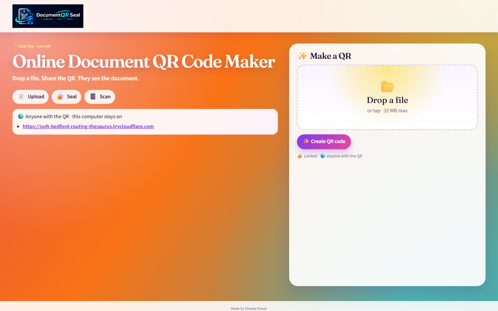
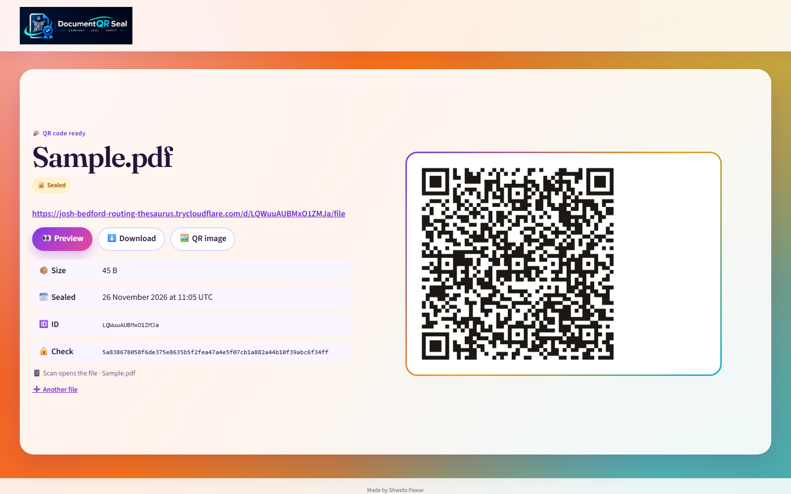

# Online Document QR Code Maker


Drop one file. Get a QR code. A scan opens that document.


## Screens

The site uses the full window: header, workspace, and footer.

**Home**



**QR ready**



## What a scan does

| | |
| --- | --- |
| 📄 | Opens the document itself |
| 🔐 | The sealed file cannot be replaced or edited |
| ⬇️ | Download keeps the original file name |
| 📱 | Works on mobile data when the site has a public address |

## Run

```bash
npm install
npm start
```

Open [http://localhost:8088](http://localhost:8088).

```bash
npm test
```

## Notes

- One file at a time. Images, PDFs, and other documents. Maximum 32 MB.
- A QR made on this computer uses the network address, so phones on the same Wi-Fi can open it.
- Put a public `https://…` address in `storage/public-url.txt` when the site should open from mobile data or another Wi-Fi. This computer has to stay on.
- The address in a saved QR stays the same only while the site stays online at that address.

Made by Shweta Pawar · [shweta01818@gmail.com](mailto:shweta01818@gmail.com)
